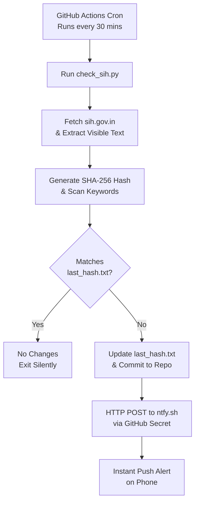

# SIH 2026 Result Watcher

A lightweight, serverless Python bot running on **GitHub Actions** that monitors `sih.gov.in` every 30 minutes and sends an instant push notification to your phone via **ntfy.sh** the moment the page updates or result keywords appear.


---

## Architecture



---

## Features

- **Zero Cost & Serverless:** Runs entirely on GitHub Actions (no VPS or local machine needed).
- **Change Detection:** Uses SHA-256 hashing to catch *any* text update on the SIH portal.
- **Keyword Matching:** Scans for terms like `shortlisted`, `result`, and `grand finale 2026`.
- **Instant Push Alerts:** Uses [ntfy.sh](https://ntfy.sh/) - no account sign-up or email passwords required.

---

## Project Structure

```text
.
├── .github/
│   └── workflows/
│       └── check.yml      # Cron schedule, Python setup, and auto-commit job
├── check_sih.py           # Scraper, hasher, and ntfy notification script
├── last_hash.txt          # Auto-generated state file (tracks last known page hash)
└── README.md
```

---

## Setup Guide

### 1. Subscribe on Your Phone (ntfy)
1. Install the **ntfy** app ([Android](https://play.google.com/store/apps/details?id=io.heckel.ntfy) / [iOS](https://apps.apple.com/us/app/ntfy/id1625396347)).
2. Tap **+** and subscribe to a hard-to-guess topic name (e.g., `sih-2026-alert-9x8k2m`).
   > Treat your topic name like a password - anyone who knows it can view or send messages to it.

### 2. Add Your GitHub Secret
1. Go to your repository **Settings → Secrets and variables → Actions**.
2. Click **New repository secret**.
3. Set **Name** to `WEBHOOK_URL` and **Value** to `https://ntfy.sh/your-secret-topic-name`.

### 3. Enable Workflow Permissions
1. Go to **Settings → Actions → General**.
2. Scroll to **Workflow permissions**, select **Read and write permissions**, and click **Save** (required so the action can commit `last_hash.txt`).

### 4. Test It
Go to the **Actions** tab → **SIH 2026 Result Watcher** → **Run workflow**.  
The first run creates `last_hash.txt` and sends a test alert to your phone. After that, it stays silent until `sih.gov.in` changes.

---

## Customization

- **Check Frequency:** Edit the `cron` expression in `.github/workflows/check.yml` (default: `'*/30 * * * *'` for every 30 minutes).
- **Keywords:** Modify the `KEYWORDS` list at the top of `check_sih.py`.
